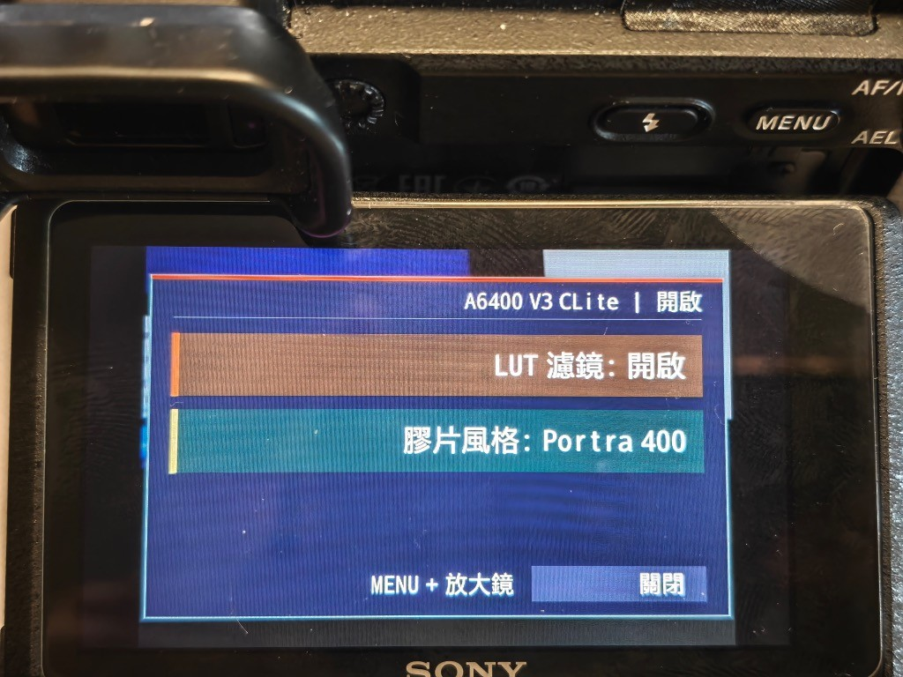
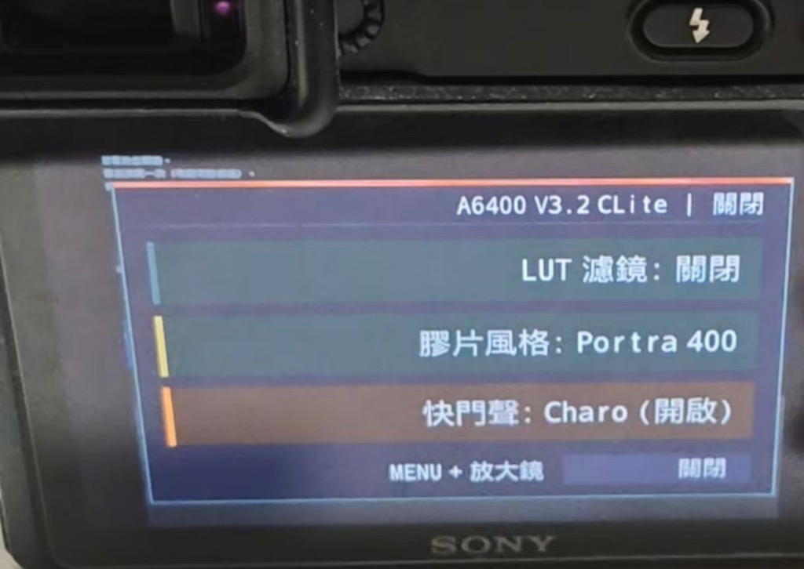
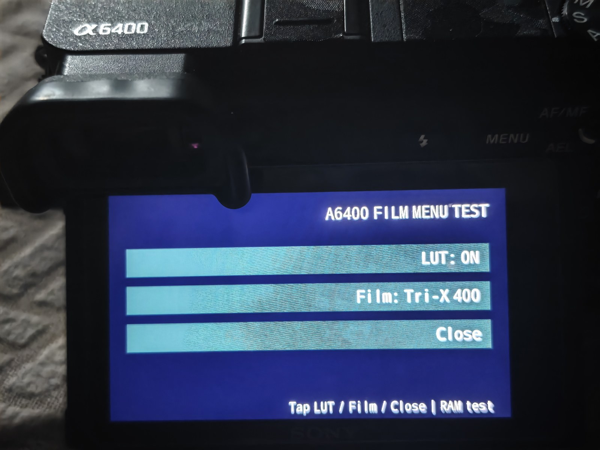
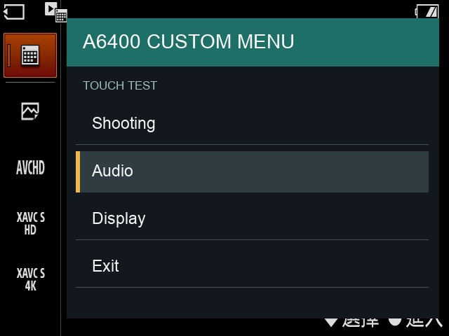
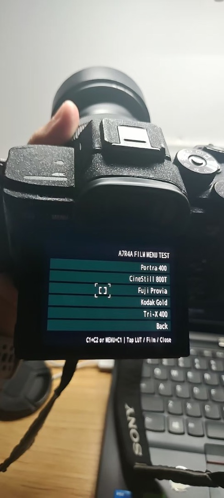

# A6400 Extra-Menu



*Sony A6400 自製觸控浮層選單：半透明深色浮動卡片、Sony Alpha 橘金狀態高亮、繁體中文介面與左下角即時處理進度提示條（Toast HUD）。*

以 **MENU＋放大鏡** 召喚自製觸控浮層選單，在 Sony A6400（FW 2.00）機身上純 RAM 掛載管理 LUT 開關、10 款膠片模擬、**`1.7MP 極速` / `6MP 高清` 雙畫質切換**、**「膠片細節」顆粒強度 (`0–3`) 與底片光暈 (`開/關`) 獨立調節**，以及左下角即時處理進度提示條的研究專案。

**最新版本：V3.5.1 Fast SP（2026-11-19，實機冷開機實拍驗證通過）**

- **`1.7MP 極速 (1616×1080)` 實測**：`RAM_JOB_TIMING = 5,650 ~ 5,950 ms`（V3.5 Fast 為 `8.16 s`；從 V3.1 單張全解析的 `18.9 s` 壓縮至約 **6 秒等級**）
- **`6MP 高清 (3000×2000)` 實測**：`RAM_JOB_TIMING = 17,490 ms`（關閉顆粒/光暈，較 V3.4 `33.41 s` 省下近 **16 秒**、較 V3.5 `20.96 s` 再快 **3.47 秒**）

> **本專案仍在持續開發與演進。** 主要文件使用繁體中文，採 **PolyForm Noncommercial 1.0.0**（非商業用途之原始碼公開授權，正式條款見 [LICENSE](LICENSE)，中文重點見 [授權說明](docs/授權說明.md)）。已驗證的功能、硬體限制（含 Cortex-A5 無 NEON 實測確認）與操作邊界請參閱 [功能狀態與限制](docs/功能狀態.md) 與 [開發與架構細節](docs/開發與架構細節.md)。

> ### 📘 快速入口：從 GitHub 原始碼完整建置／部署 V3.5.1 Fast SP ＋ 開發細節
> - **[從原始碼建置、部署與操作規範（docs/部署與操作規範.md）](docs/部署與操作規範.md)** — 收錄從源碼交叉編譯、全自動 PMCA 寫入（自動偵測並修補全新機身開機掛勾 `/tmp/a6400-autoexec.so`）、冷開機驗收、**日常使用限制（最新資料夾 1,024 張上限／15.94 MiB／exFAT 與 FAT32 皆可用／`/A6400/TEST/`）** 與救援／回滾步驟。
> - **[開發與架構細節（docs/開發與架構細節.md）](docs/開發與架構細節.md)** — 完整記錄 V3.1 → V3.2 → V3.4 LTR → V3.5 Fast → V3.5.1 Fast SP 的演進脈絡、硬體 `/proc/cpuinfo`（無 NEON）、解碼/編碼/Shell 各階段毫秒拆解、`1120-byte` UI 快照 ABI 與 `manifest.json` 欄位說明。
> - **📦 [前往 GitHub Releases 下載最新預編譯一鍵懶人包（A6400-V3.5.1-Fast-SP-OneClick.zip）](https://github.com/PCIEARIA/A6400-Extra-Menu/releases/latest)**

---

## 版本演進總覽

| 版本 | 重點里程碑與實機數據 |
| --- | --- |
| **V3.5.1 Fast SP（最新穩定版）**<br>`package=5b079b295c2a7a27` | 1. 浮層新增第 3 列 **「膠片細節」**（`FILM_MENU_DETAILS` 子分頁）：獨立調整 **顆粒強度 `0–3`**（`無 (加速)`／`輕微`／`標準`／`濃厚`）與 **底片光暈 `開 / 關`**（關光暈時直接略過模糊遮罩計算 `mask_kib=0`）＋ 一鍵 `恢復細節預設`。<br>2. `vendor/jpge.cpp` 開啟 `-O3`、精簡 `DCT_MUL`、移除子閾值係數 64-bit 乘法、`inline put_bits`、`noinline flush_output_buffer`（標準參數下輸出與 V3.5 100% 位元一致）。<br>3. `camera/author_film.c` 預先縮放 `bell_scaled[256]` 並將光暈水平模糊改為 **`O(1)` 滑動視窗**。<br>4. `camera/film_ram_job.sh` 改用 `busybox ls -ln` 單次 `lstat` 取代 `wc -c` 全檔掃描，消除 `>1 秒` 讀取預檢空檔；並將雙畫質切換從可選快門音效條件中解耦，公開編譯即可使用全部新介面。<br>5. 實機實測：**`1.7MP` `5.65~5.95 s`**、**`6MP` `17.49 s`**。 |
| **V3.5 Fast**<br>`package=ff85fe8a9a317b68` | 引入 `picojpeg` 8-bit Huffman 快表與 `6MP`（`3000×2000`）真半尺度 IDCT（跳過 8×8 完整運算直接取 DC/半尺度像素），`6MP` 由 `33.41 s` 降至 `20.96 s`，`1.7MP` 實測 `8.16 s`。 |
| **V3.4 Base LTR**<br>`package=2bdd6b742789b8e7` | 新增主選單左下角 **`畫質: 1.7MP 極速 / 6MP 高清`** 一鍵切換、`F<原檔後4碼><3碼亂數>.JPG` 原圖編號直觀對應、以及完整 RAM 任務分段計時 `RAM_JOB_TIMING`。 |
| **V3.2 Universal / Charo** | 導入執行期動態抽取機身 `/usr/lib/libAK8975.so` 自動修補 `/tmp/a6400-autoexec.so`、跨開機動態掃描 `im.elf` PID（`im_pid_find.h`）、並可選擇編譯個人快門音效掛勾。 |
| **V3.1 CLite（歷史回滾基準）**<br>`package=77e49f2132ca0878` | 左下角即時進度條 `a6400_ui_toast_v1`、`-O2` 編譯與精簡寫卡雜湊驗證（單張約 `18.9 s`，歷史基準保留於 `v3.1-clite-toast-stable-20261118`）。 |

---

## 外觀版本對照

| 版本 | 說明與實機畫面 |
| --- | --- |
| **V3.1 CLite（半透明卡片基礎外觀）** | 半透明深色浮動卡片、頂部 Sony Alpha 橘條、`LUT 濾鏡` 與 `膠片風格` 橘金側條高亮、右下角獨立 `關閉`／`返回` 按鈕、繁體中文顯示與左下角 Toast HUD；**V3.4～V3.5.1 Fast SP** 均沿用此卡片視覺規範並擴充第 3 列與左下角畫質切換鈕。<br> |
| **V3.2 CLite（個人自訂快門音效擴充畫面）** | 於主選單加入 `快門聲: Charo (開啟)` 開關（音檔屬個人資產不隨本公開倉庫附帶；`tools/build_v3_clite.sh` 會於存在 `assets/a6400-charo-shutter.pcm` 時自動啟用，無音檔時自動編譯為無音效之標準 **V3.5.1 Fast SP**）。<br> |
| **V1 Beta（早期初版）** | 早期實機驗證版本，採全屏深色不透明背景、等寬純英文條狀按鈕（`LUT: ON/OFF`、`Film`、`Close`）。<br> |
| **V0 早期測試原形** | 最早期的自製 OSD 觸控選單介面試驗畫面（`A6400 CUSTOM MENU / TOUCH TEST`）。<br> |
| **社群跨機身移植紀錄（`A7R4A`）** | 2026-11-17 社群開發者基於本專案架構移植至 Sony A7R4A 之選單點亮紀錄（僅作開發參考，非 A6400 機身之地址須自行校準）。<br> |

---

## 核心功能與元件構成

- **強化浮層選單與即時 Toast HUD（`camera/film_menu.*`、`camera/film_native_view.*`、`camera/native_film_ui_trial3.c`）**：
  - 主選單包含：`LUT 濾鏡`、`膠片風格`（雙頁 10 款）、**`膠片細節`**（進入 `FILM_MENU_DETAILS` 調節 `顆粒強度 0–3` 與 `底片光暈 開/關`）、（選用）`快門聲`、左下角 **`畫質: 1.7MP 極速 / 6MP 高清`**，以及右下角 `關閉`。
  - 維持 `_Static_assert(sizeof(ui) == 1120)` 原始快照 ABI 不變，透過獨立導出符號 `a6400_ui_toast_v1`（magic `0x54534f54`）與 `a6400_ui_hires_v1` 和守護行程安全通訊。
- **10 款自研定點膠片引擎＋公開版高速解編碼（`camera/author_film.c`、`author_curves.h`、`film_jpeg.cpp`、`vendor/picojpeg.*`、`vendor/jpge.*`）**：
  - 全面採用自研定點色彩矩陣、3D LUT／色調曲線、預先縮放粒子查找表與滑動視窗光暈，搭配 Public Domain 的 `picojpeg`（8-bit Huffman 快表 + 半尺度 IDCT）與 `jpge`（`-O3` + 快速量化與位元寫入），**完全不依賴任何未授權第三方濾鏡引擎**。
  - **10 款預設**：`Portra 400`、`CineStill 800T`、`Fuji Provia`、`Kodak Gold`、`Tri-X 400`、`Classic Chrome`、`Agfa Ultra 100`、`Polaroid 669`、`Fuji Acros`、`Polaroid PX680+`。
- **一鍵交叉編譯與全自動 PMCA 部署（`tools/build_v3_clite.sh`、`tools/pmca_deploy_v3_clite.py`）**：
  - 9 階段編譯自動產生不超過 `196,608` bytes（實測 `194,560 B`）的純 RAM 開機包 `a6400-film-boot-v15.tar`。
  - `assets/a6400-charo-shutter.pcm` 改為選用：一般使用者無需自備音效檔即可直接編譯出完整功能的 V3.5.1 Fast SP。
- **照片掃描、exFAT/FAT32 原生存取與安全性（`camera/film_capture_daemon.c`、`native_capture_probe.c`、`film_native_command.c`、`film_ram_job.sh`）**：
  - 守護行程佇列上限為 **`1024`**（`FILM_CAPTURE_PERSISTENT=1`），支援最新 DCF 目錄提示直掃與 `mmc0` 中斷觸發。
  - 讀寫記憶卡全程透過 Sony 原生 `mwf_monio` `IFSYS` 介面存取，**`FAT32` 與大容量 `exFAT`（如 64GB／128GB SDXC）皆可直接使用**。

---

## 實機與主機端實測進度（截至 2026-11-19）

| 項目 | 實測狀態與數據 |
| --- | --- |
| MENU＋放大鏡召喚、觸控關閉、重複開關 | 已於多代實機驗證（V3.5.1 Fast SP 維持 `20 秒` 閒置自動隱藏與無限重複召喚） |
| **1.7MP / 6MP 畫質切換 ＋ 膠片細節（顆粒 0–3／光暈 開關）** | **已於實機冷開機實拍驗證**（切換 `grain=0 halation=0` 後，`MENU_JOB` 與 `RAM_JOB_RENDER_START` 即時套用） |
| **`1.7MP 極速` 冷開機單張總耗時（`RAM_JOB_TIMING`）** | **`5,650 ms` / `5,950 ms`**（V3.5.1 Fast SP 實拍 `A6409839`、`A6409840`；`WAITING → JOB_DONE` 約 `6.36~6.60 s`） |
| **`6MP 高清` 冷開機單張總耗時（`RAM_JOB_TIMING`）** | **`17,490 ms`**（V3.5.1 Fast SP 實拍 `A6409842`；V3.5 Fast 為 `20,960 ms`、V3.4 為 `33,410 ms`） |
| CPU 硬體實測（`/proc/cpuinfo`） | **`ARMv7 Cortex-A5`（`0xc05`）**，`Features: vfpv3 vfpv3d16 tls vfpv4` — **實機無 NEON SIMD** |
| Host Benchmark（位元正確性驗證） | 預設 `grain=2 halation=1` 下，`1.7MP`（`bb3936f2...`）與 `6MP`（`708edf69...`）輸出與 V3.5 Fast **100% SHA-256 一致** |
| 連拍寫卡競態安全保護（`stage=source_size`） | 實拍 `A6409841` 時遇到最後 `64 KiB` 延遲寫入（`8,388,608 != 8,454,144`），安全中止且無損原片與記憶卡，下一張自動恢復 |
| 即時取景套色、影片 LUT、任意 `.cube` 匯入 | 本專案不提供 |

---

## 濾鏡實作與授權說明

V3 起之全部 10 款膠片預設均已採用本專案獨立撰寫之定點色彩矩陣、3D LUT／色調曲線、粒子與光暈演算法（[`camera/author_film.c`](camera/author_film.c)、[`camera/author_curves.h`](camera/author_curves.h)），搭配 Public Domain 的 `picojpeg` 與 `jpge`，**已完整包含在本倉庫內並隨本專案一併釋出可編譯原始碼**，不再依賴早期私人研究曾接駁之未授權上游預設。第三方元件聲明見 [THIRD_PARTY.md](THIRD_PARTY.md)。

---

## 在電腦上執行測試與部署入口

需要 Python 3.10 以上、C 編譯器（`cc`），以及一般 POSIX 開發環境。測試只在暫存目錄操作合成資料，**不會連接相機、修改記憶體或掛載 SD 卡**。

```sh
git clone https://github.com/PCIEARIA/A6400-Extra-Menu.git
cd A6400-Extra-Menu
python3 -m unittest discover -p 'test_*.py' -v
python3 tools/check_public_tree.py
```

若要從本倉庫進行相機端交叉編譯、組裝套件並透過 `Sony-PMCA-RE` 部署到 A6400（FW 2.00），請閱讀 **[部署與操作規範](docs/部署與操作規範.md)**、**[編譯與目錄說明](docs/編譯與目錄.md)** 與 **[開發與架構細節](docs/開發與架構細節.md)**。

## 授權與致謝

- 本專案新增部分：[PolyForm Noncommercial 1.0.0](LICENSE)（商業使用須另行取得授權）。
- 沿用的 MIT / Public Domain 元件：見 [THIRD_PARTY.md](THIRD_PARTY.md)。
- 完整致謝見 [ACKNOWLEDGEMENTS.md](ACKNOWLEDGEMENTS.md)。Sony、Kodak、Fujifilm、CineStill 等名稱僅用於描述相容性或模擬色彩選項，本專案並非上述公司之官方產品。
